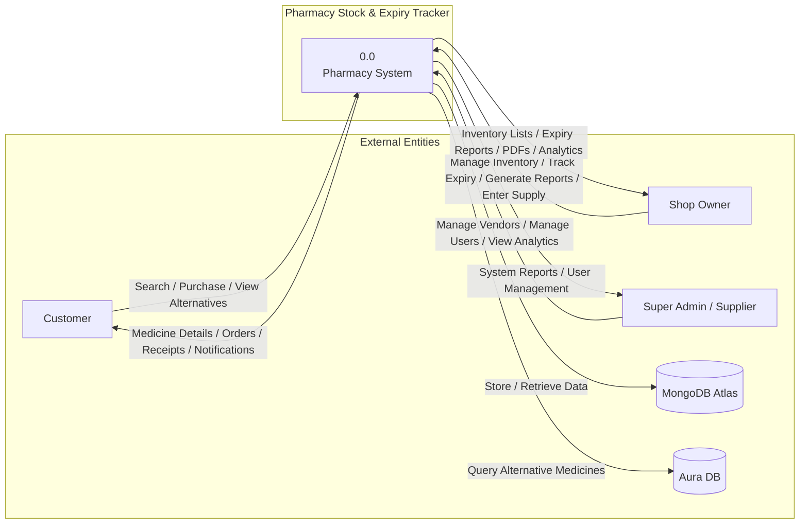
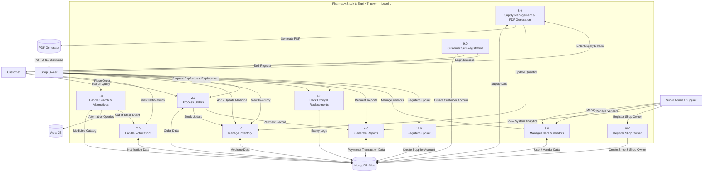
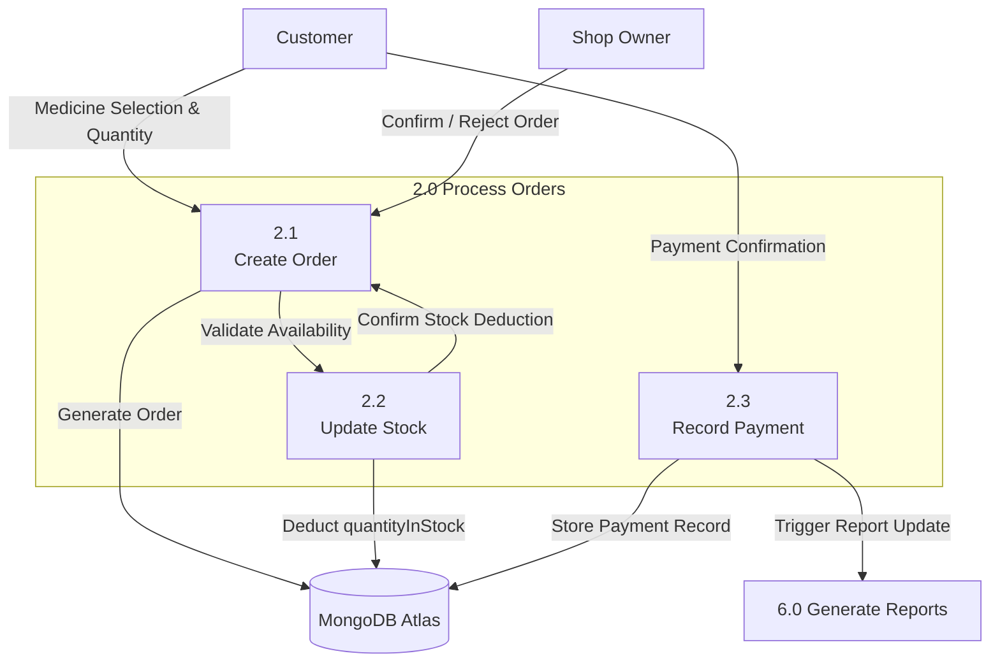
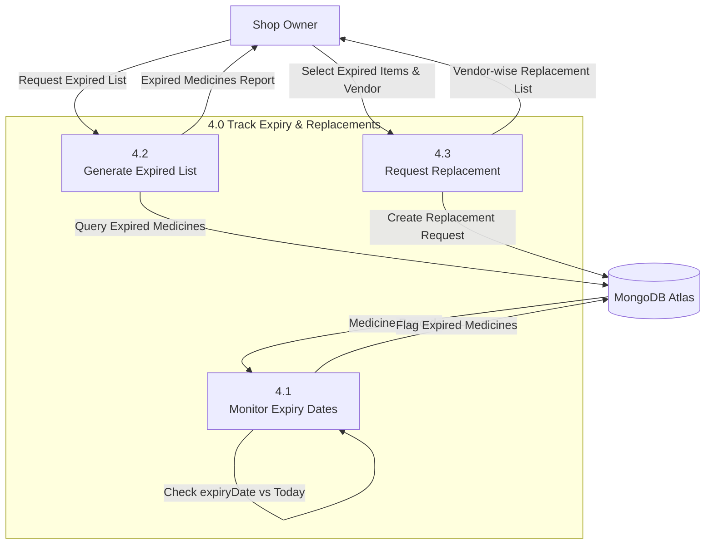
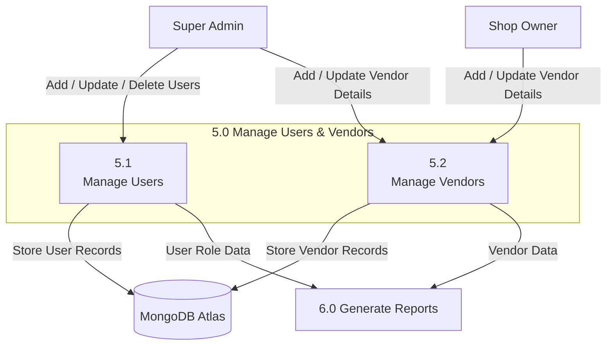
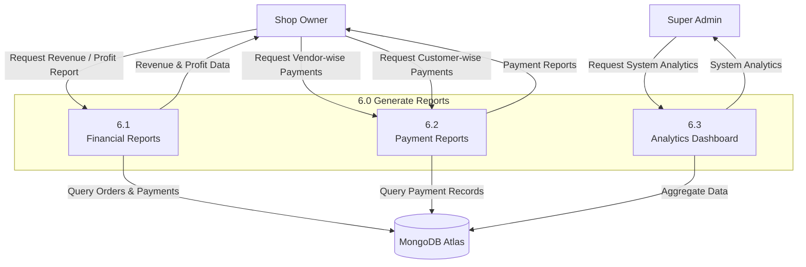
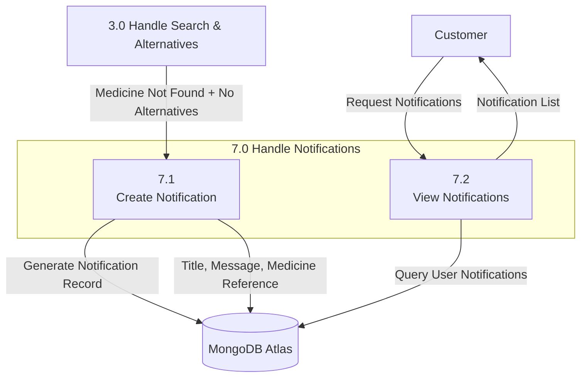
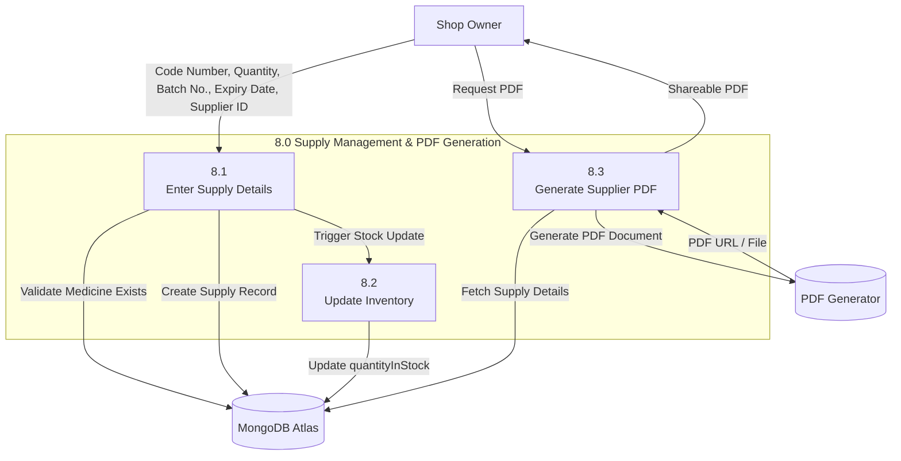

# Data Flow Diagrams (DFD) — Pharmacy Stock & Expiry Tracker

## DFD Level 0 — Context Diagram

Level 0 shows the entire system as a single process and its interactions with external entities (users and external systems).



---

## DFD Level 1 — System Decomposition

Level 1 breaks the system into major functional processes and shows data flows between them.



---

## DFD Level 2 — Detailed Process Flows

### 2.1 Manage Inventory (1.0)

```mermaid
flowchart TD
    SO[Shop Owner]
    DB[(MongoDB Atlas)]

    subgraph P1["1.0 Manage Inventory"]
        1.1["1.1\nAdd / Update Medicine"]
        1.2["1.2\nView Inventory"]
        1.3["1.3\nUpdate Stock Level"]
    end

    SO -->|Medicine Details\n(codeNumber, type, system, quantityUnit, imageUrl, manufactureDate, expiryDate)| 1.1
    SO -->|Search / Filter Request| 1.2
    SO -->|Quantity Adjustment| 1.3

    1.1 -->|Validate & Store Medicine| DB
    1.2 -->|Retrieve Medicine List| DB
    1.3 -->|Update quantityInStock| DB

    1.3 -.->|Trigger Reorder Alert| 1.1
```

### 2.2 Process Orders (2.0)



### 2.3 Handle Search & Alternatives (3.0)

```mermaid
flowchart TD
    C[Customer]
    DB[(MongoDB Atlas)]
    AURA[(Aura DB)]
    P7[7.0 Handle Notifications]

    subgraph P3["3.0 Handle Search & Alternatives"]
        3.1["3.1\nSearch Medicines"]
        3.2["3.2\nSuggest Alternatives"]
    end

    C -->|Search Query\n(name, type, system, category)| 3.1
    3.1 -->|Query Medicines| DB
    DB -->|Return Results| 3.1
    3.1 -->|Medicine Details + Images| C

    3.1 -->|Out of Stock Event| 3.2
    3.2 -->|Query Alternatives| AURA
    AURA -->|Alternative Medicine List| 3.2
    3.2 -->|Show Alternatives| C

    3.2 -->|No Alternative Found| P7
```

### 2.4 Track Expiry & Replacements (4.0)



### 2.5 Manage Users & Vendors (5.0)



### 2.6 Generate Reports (6.0)



### 2.7 Handle Notifications (7.0)



### 2.8 Supply Management & PDF Generation (8.0)



---

## Data Flow Summary

| Process | Inputs | Outputs | Data Store |
|---------|--------|---------|------------|
| 1.0 Manage Inventory | Medicine details, stock adjustments | Updated inventory, reorder alerts | MongoDB Atlas |
| 2.0 Process Orders | Medicine selection, payment confirmation | Order confirmation, stock deduction | MongoDB Atlas |
| 3.0 Handle Search & Alternatives | Search query | Medicine results, alternative suggestions | MongoDB Atlas, Aura DB |
| 4.0 Track Expiry & Replacements | Expiry scan, replacement request | Expired list, vendor-wise replacement report | MongoDB Atlas |
| 5.0 Manage Users & Vendors | User/Vendor details | User accounts, vendor records | MongoDB Atlas |
| 6.0 Generate Reports | Report request | Revenue, profit, payment reports | MongoDB Atlas |
| 7.0 Handle Notifications | Out-of-stock event | Notification records | MongoDB Atlas |
| 8.0 Supply Management & PDF Generation | Supply details, PDF request | Supply records, updated stock, PDF | MongoDB Atlas, PDF Generator |
| 9.0 Customer Self-Registration | Registration details | Customer account | MongoDB Atlas |
| 10.0 Register Shop Owner | Shop owner details, shop details | Shop record, shop owner account | MongoDB Atlas |
| 11.0 Register Supplier | Supplier details | Supplier account | MongoDB Atlas |

---

## External Data Stores

| Data Store | Description | Used By |
|------------|-------------|---------|
| MongoDB Atlas | Primary database for medicines, users, orders, payments, expiry logs, alternatives, notifications, supplies | All processes |
| Aura DB | Alternative medicine suggestion engine | 3.0 Handle Search & Alternatives |
| PDF Generator | Generates shareable supplier PDFs | 8.0 Supply Management & PDF Generation |

---

## Notes

- All data flows between processes and data stores use RESTful or GraphQL APIs.
- Real-time updates ensure stock levels, expiry status, and notifications are immediately reflected.
- The PDF generation process is asynchronous to avoid blocking the supply entry workflow.
- Notifications are triggered automatically when a medicine search yields no results and no alternatives are available.
