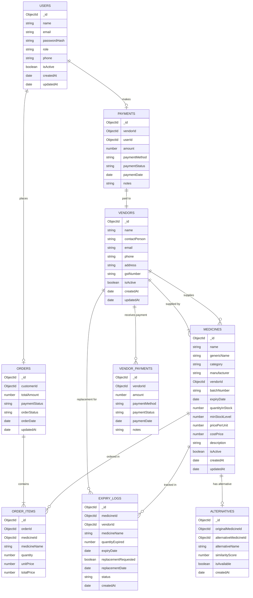

# ERD Diagram — Pharmacy Stock & Expiry Tracker (NoSQL / MongoDB)

## Mermaid ER Diagram



## Collection Schemas (JSON Document Structure)

### 1. Users Collection
Stores all user types (Customer, Shop Owner, Super Admin).

```json
{
  "_id": { "$oid": "..." },
  "name": "John Doe",
  "email": "john@example.com",
  "passwordHash": "bcrypt_hash",
  "role": "customer",
  "phone": "+91-9876543210",
  "address": {
    "street": "123 Main St",
    "city": "Mumbai",
    "state": "Maharashtra",
    "pincode": "400001"
  },
  "isActive": true,
  "createdAt": { "$date": "2026-08-29T00:00:00Z" },
  "updatedAt": { "$date": "2026-08-29T00:00:00Z" }
}
```

### 2. Medicines Collection
Main inventory collection with embedded stock and expiry info.

```json
{
  "_id": { "$oid": "..." },
  "name": "Paracetamol 500mg",
  "genericName": "Acetaminophen",
  "category": "Painkiller",
  "manufacturer": "ABC Pharma",
  "supplierId": { "$oid": "supplier_id" },
  "batchNumber": "BATCH-001",
  "expiryDate": { "$date": "2026-12-31" },
  "quantityInStock": 150,
  "minStockLevel": 20,
  "pricePerUnit": 2.50,
  "costPrice": 1.80,
  "description": "Used for pain relief and fever reduction",
  "isActive": true,
  "createdAt": { "$date": "2026-08-29T00:00:00Z" },
  "updatedAt": { "$date": "2026-08-29T00:00:00Z" }
}
```

### 3. Suppliers Collection
Supplier and vendor management.

```json
{
  "_id": { "$oid": "..." },
  "name": "XYZ Pharmaceuticals",
  "contactPerson": "Jane Smith",
  "email": "contact@xyzpharma.com",
  "phone": "+91-9876543211",
  "address": {
    "street": "456 Industrial Area",
    "city": "Pune",
    "state": "Maharashtra",
    "pincode": "411001"
  },
  "gstNumber": "GST123456789",
  "isActive": true,
  "createdAt": { "$date": "2026-08-29T00:00:00Z" },
  "updatedAt": { "$date": "2026-08-29T00:00:00Z" }
}
```

### 4. Orders Collection
Customer purchase orders.

```json
{
  "_id": { "$oid": "..." },
  "customerId": { "$oid": "customer_user_id" },
  "items": [
    {
      "medicineId": { "$oid": "medicine_id" },
      "medicineName": "Paracetamol 500mg",
      "quantity": 2,
      "unitPrice": 2.50,
      "totalPrice": 5.00
    }
  ],
  "totalAmount": 5.00,
  "paymentStatus": "paid",
  "orderStatus": "completed",
  "orderDate": { "$date": "2026-08-29T10:30:00Z" },
  "updatedAt": { "$date": "2026-08-29T10:30:00Z" }
}
```

### 5. Payments Collection
Tracks all financial transactions.

```json
{
  "_id": { "$oid": "..." },
  "vendorId": { "$oid": "vendor_id" },
  "userId": { "$oid": "user_id" },
  "amount": 1500.00,
  "paymentMethod": "bank_transfer",
  "paymentStatus": "completed",
  "paymentDate": { "$date": "2026-08-29T00:00:00Z" },
  "notes": "Monthly payment for August",
  "createdAt": { "$date": "2026-08-29T00:00:00Z" }
}
```

### 6. ExpiryLogs Collection
Tracks expired medicines and replacement requests.

```json
{
  "_id": { "$oid": "..." },
  "medicineId": { "$oid": "medicine_id" },
  "supplierId": { "$oid": "supplier_id" },
  "medicineName": "Paracetamol 500mg",
  "quantityExpired": 50,
  "expiryDate": { "$date": "2026-08-15" },
  "replacementRequested": true,
  "replacementDate": { "$date": "2026-08-20" },
  "status": "replaced",
  "createdAt": { "$date": "2026-08-29T00:00:00Z" }
}
```

### 7. Alternatives Collection (Aura DB)
Stores alternative medicine suggestions for out-of-stock items.

```json
{
  "_id": { "$oid": "..." },
  "originalMedicineId": { "$oid": "medicine_id" },
  "alternativeMedicineId": { "$oid": "alt_medicine_id" },
  "alternativeName": "Crocin 500mg",
  "similarityScore": 0.95,
  "isAvailable": true,
  "createdAt": { "$date": "2026-08-29T00:00:00Z" }
}
```

## Relationship Summary

| Relationship | Type | MongoDB Pattern |
|--------------|------|-----------------|
| User → Orders | One-to-Many | Reference (Order stores customerId) |
| Order → OrderItems | One-to-Many | Embedded array in Order |
| Medicine → Vendor | Many-to-One | Reference (Medicine stores vendorId) |
| Medicine → ExpiryLogs | One-to-Many | Reference (ExpiryLog stores medicineId) |
| Vendor → Medicines | One-to-Many | Reference |
| Vendor → Payments | One-to-Many | Reference (Payment stores vendorId) |
| Medicine → Alternatives | One-to-One | Reference (Alternative stores originalMedicineId) |

## Index Recommendations

```javascript
// Users
db.users.createIndex({ "email": 1 }, { unique: true })
db.users.createIndex({ "role": 1 })

// Medicines
db.medicines.createIndex({ "supplierId": 1 })
db.medicines.createIndex({ "expiryDate": 1 })
db.medicines.createIndex({ "name": "text", "genericName": "text" })
db.medicines.createIndex({ "quantityInStock": 1 })

// Orders
db.orders.createIndex({ "customerId": 1 })
db.orders.createIndex({ "orderDate": -1 })

// Payments
db.payments.createIndex({ "supplierId": 1 })
db.payments.createIndex({ "paymentDate": -1 })

// ExpiryLogs
db.expirylogs.createIndex({ "expiryDate": 1 })
db.expirylogs.createIndex({ "supplierId": 1 })
db.expirylogs.createIndex({ "status": 1 })
```
