# Sequence Diagrams — Pharmacy Stock & Expiry Tracker

## 1. Search Medicine (with Alternatives and Notifications)

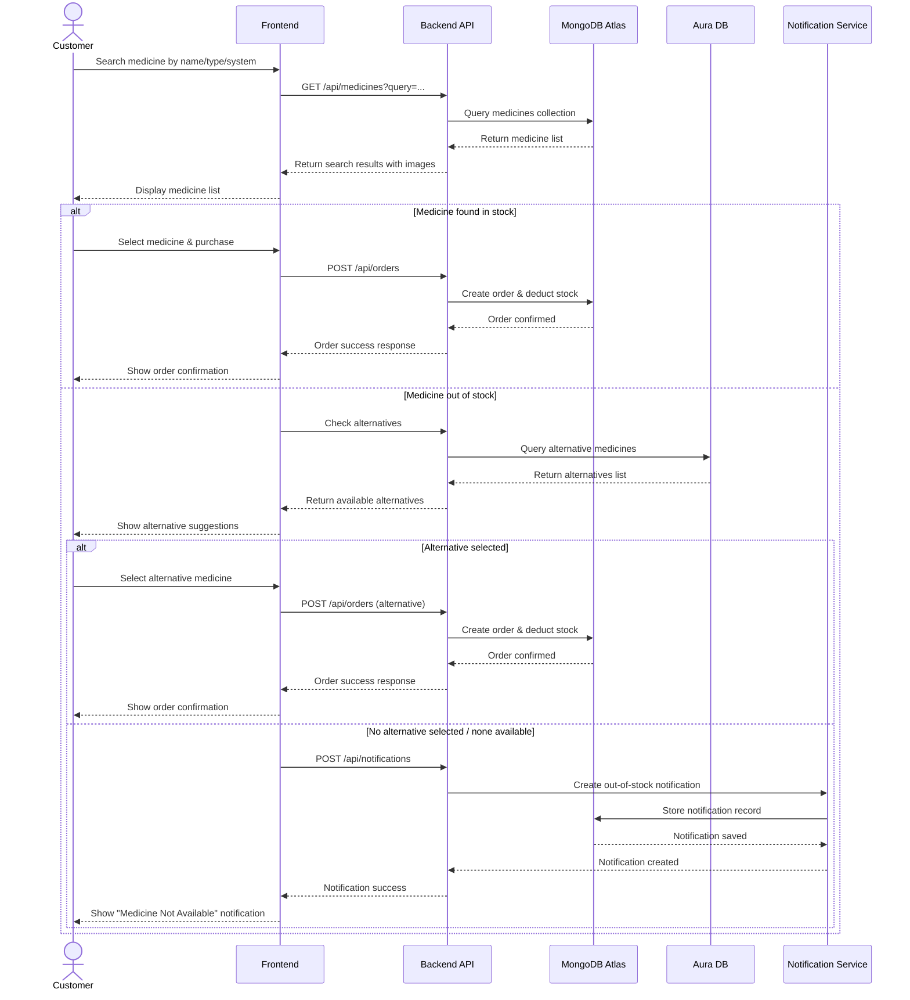

---

## 2. Purchase Medicine

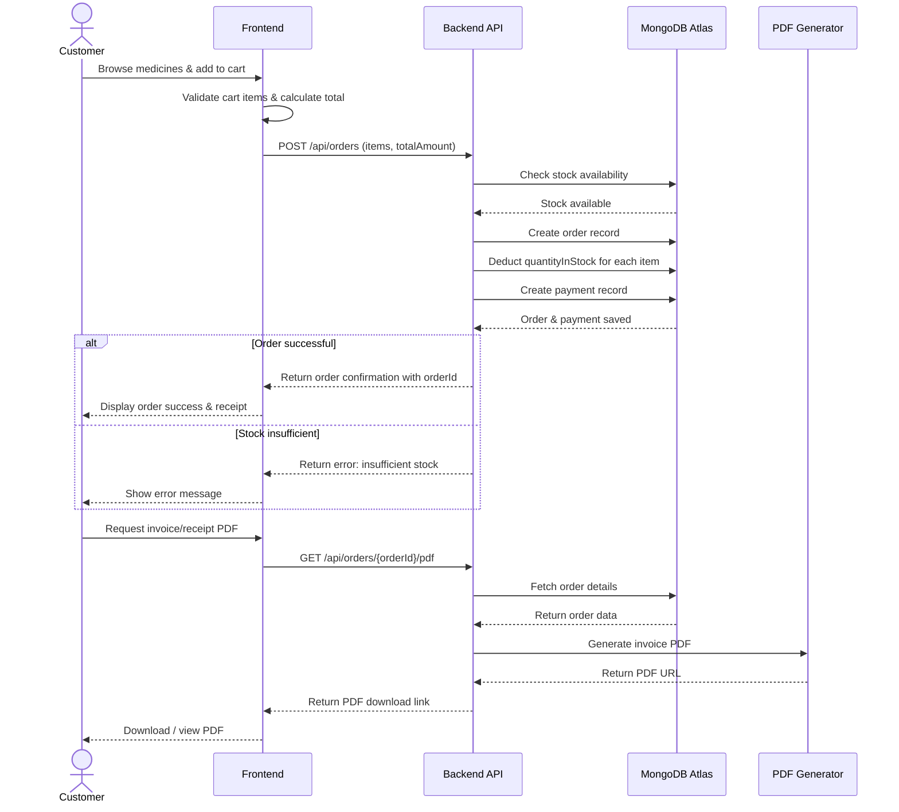

---

## 3. Enter New Supply & Generate Supplier PDF

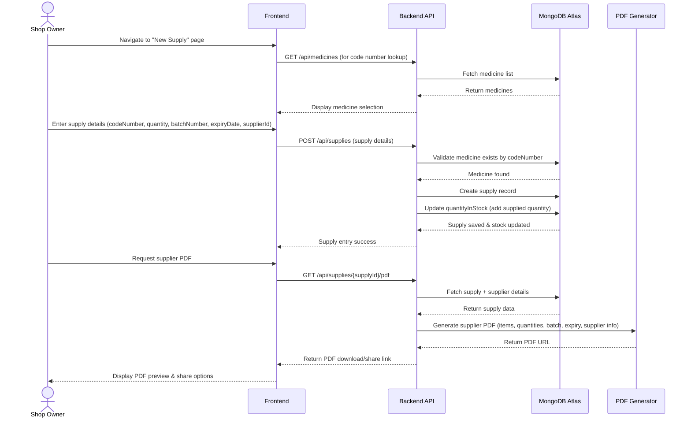

---

## 4. Track Expiry & Request Replacement

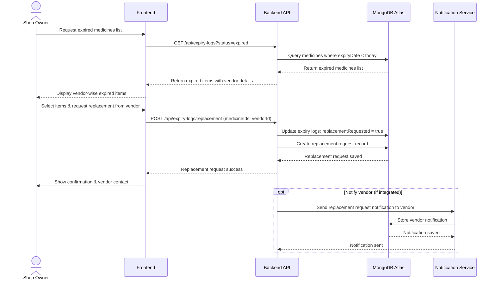

---

## 5. Generate Financial Report

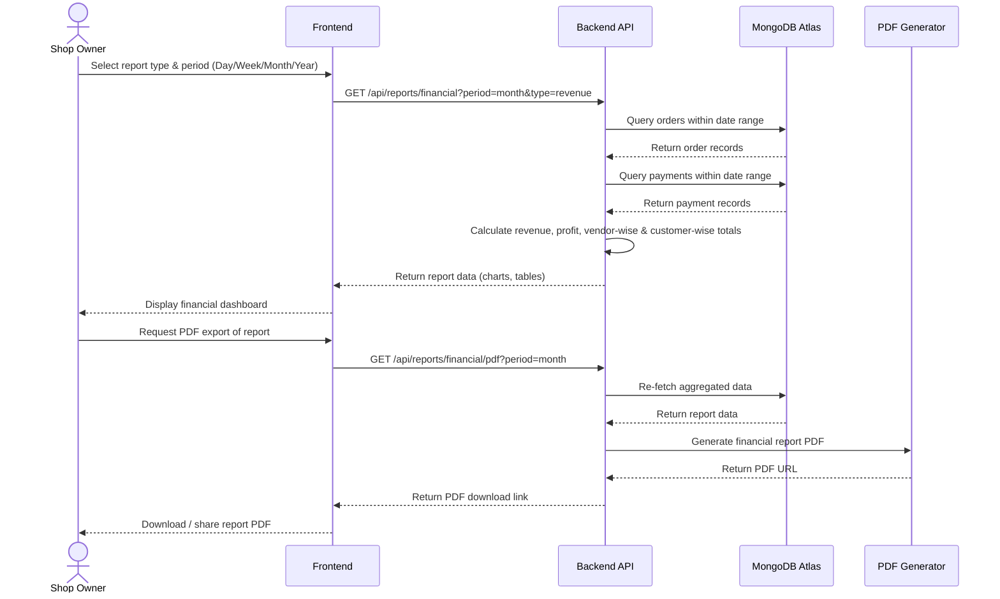

---

## 6. Manage Inventory (Add / Update Medicine)

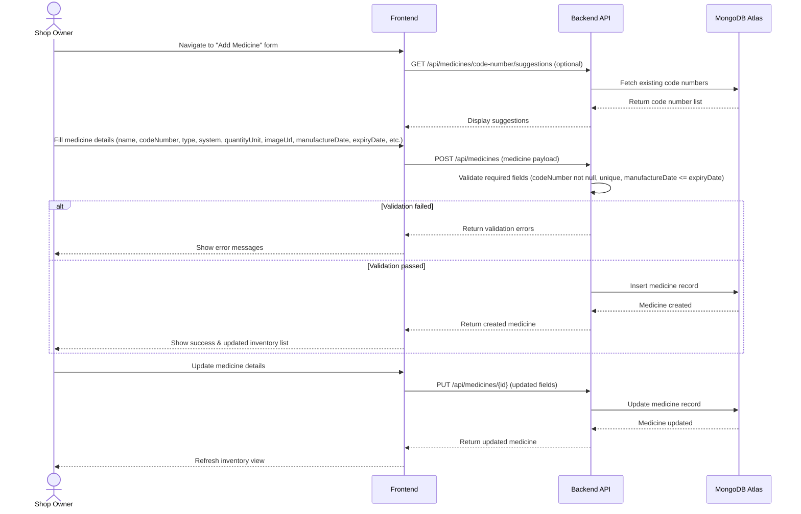

---

## 7. Manage Users & Vendors (Super Admin)

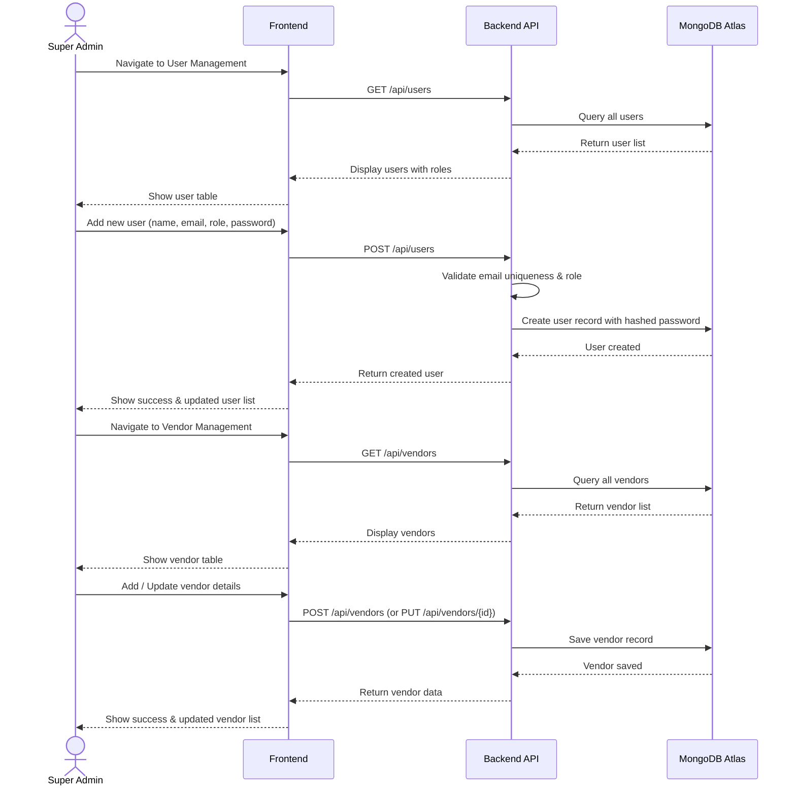

---

## 8. Customer Self-Registration

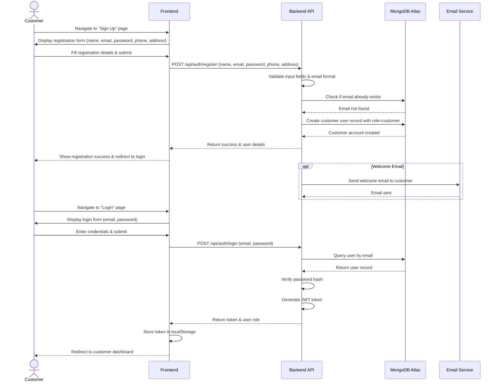

---

## 9. Register Shop Owner by Super Admin

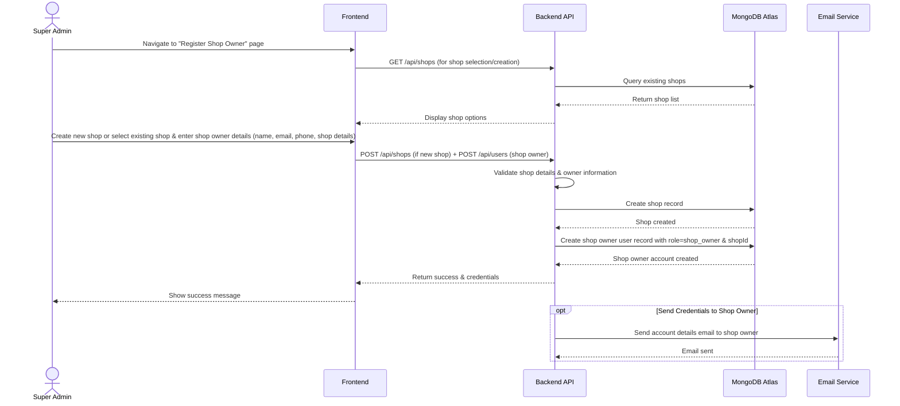

---

## 10. Register Supplier by Shop Owner

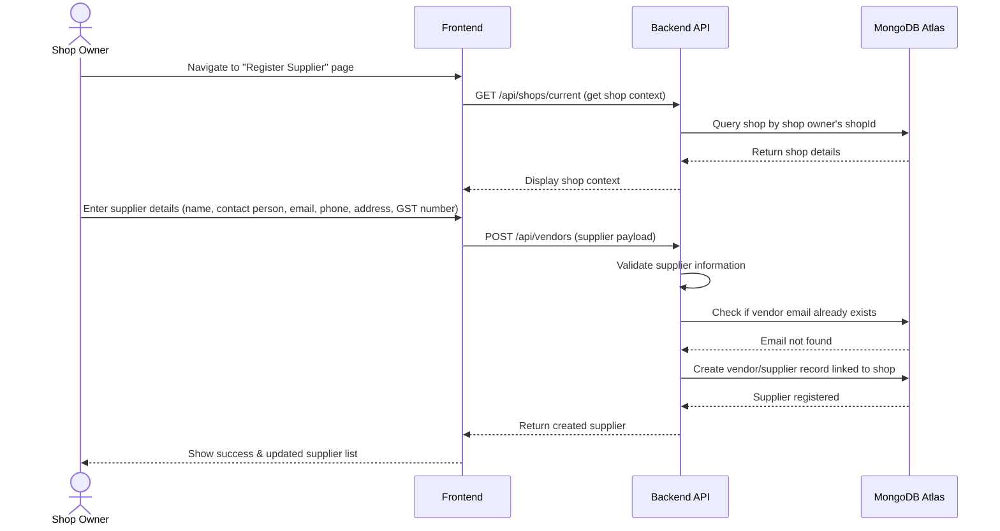

---

## 11. Customer Update Profile

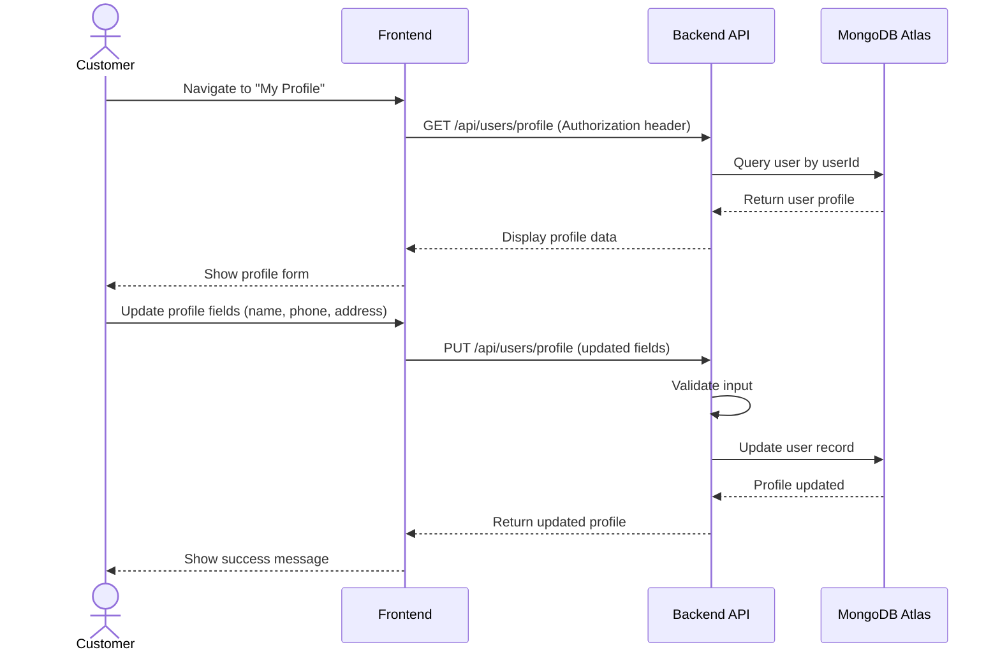

---

## 12. Customer Cancel Order

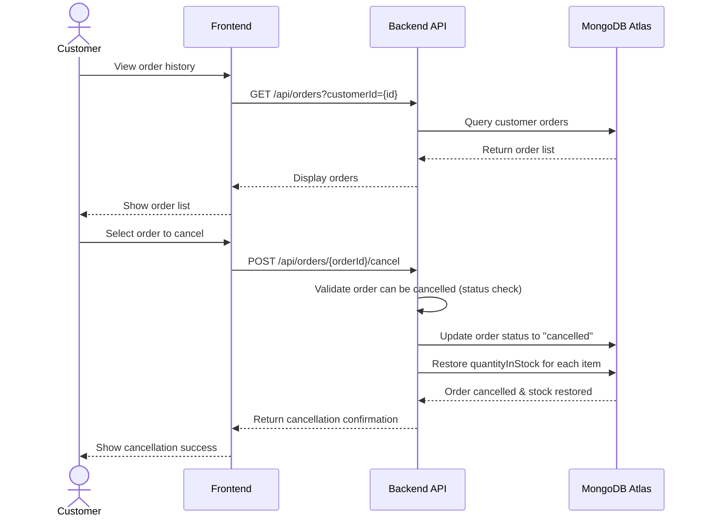

---

## 13. Customer Manage Cart

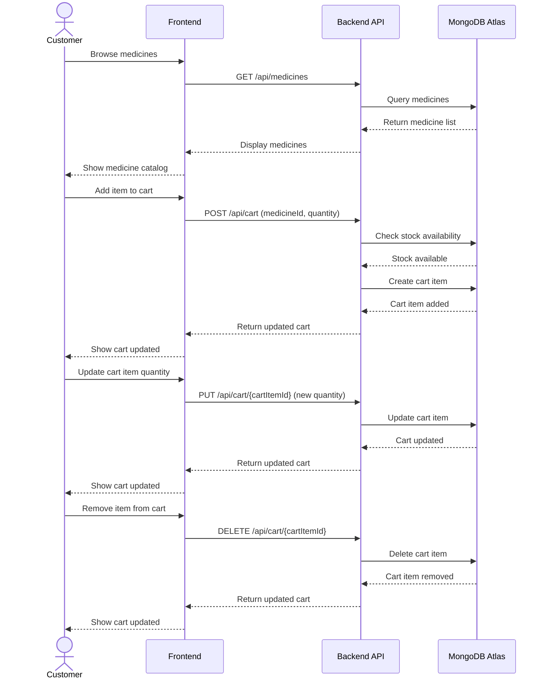

---

## 14. Shop Owner Delete Medicine

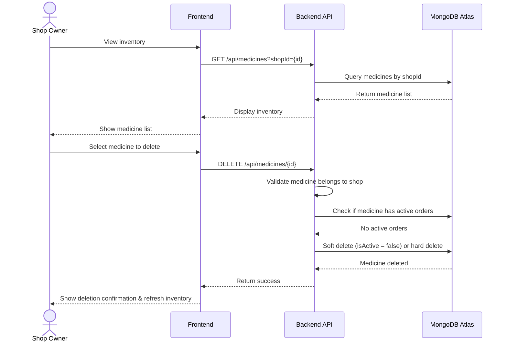

---

## 15. Super Admin Manage Users/Shops/Vendors

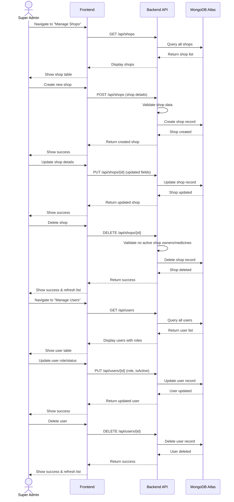

---

## Notes

- All sequence diagrams follow the lifeline order: **Actor → Frontend → Backend API → Data Store / External Service**.
- Alternative flows (alt/else) represent conditional branching based on business rules.
- Notifications and PDF generation are shown as asynchronous or triggered flows where applicable.
- Real-time updates (stock deduction, expiry monitoring) are handled via API callbacks and database updates.
- Authentication/authorization steps are implied at the API layer for all user-originated requests.
